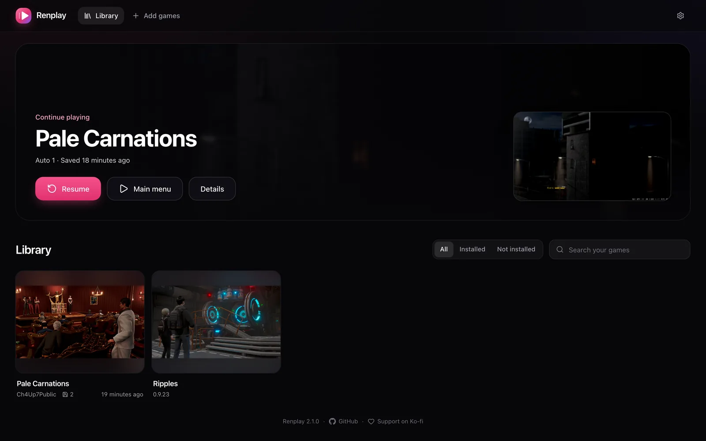
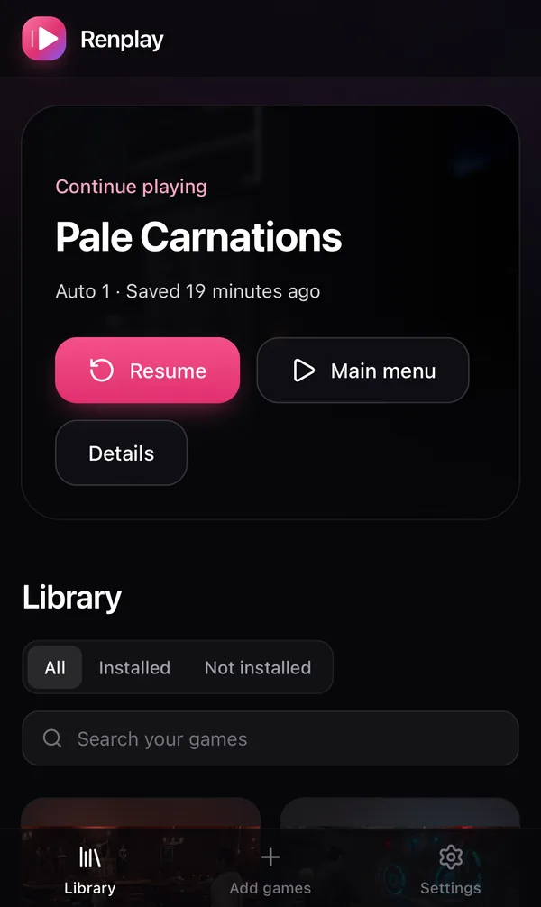
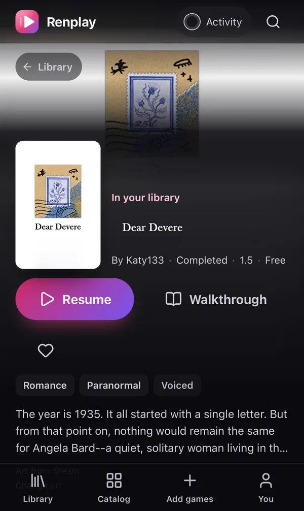

<p align="center"></p>

<h1 align="center">Renplay</h1>

<p align="center"><b>Your Ren’Py games in the browser, on any device, with saves on your own server.</b></p>

<p align="center">
  <a href="https://github.com/renplay-web/renplay/releases/latest"></a>
  <a href="LICENSE"></a>
  <a href="https://ko-fi.com/janpuc"></a>
</p>

<p align="center"></p>

Renplay is a self-hosted library for [Ren’Py](https://www.renpy.org/) visual novels. Add a game’s
normal PC download, press Install, and play it in any browser: on your computer, your tablet or
your phone. Every save lands on your server the moment you make it, so you can stop on the laptop
and continue on the phone.

<p align="center">
  
  &nbsp;
  
</p>

## What you get

- **Play anywhere.** Smooth, full-speed playback in the browser. On phones the game fills the
  screen around the camera cutout, and on iPhone it runs full screen from the home screen.
- **Saves on your server.** Saves, autosaves and progress sync as you play, with earlier versions
  kept. Sequels find the previous season’s saves, just like on desktop. Import saves from the
  desktop version, export them back, or copy them between games.
- **One-click installs.** Drop in the PC zip (or 7z, rar). Renplay unpacks it, shrinks the images
  and prepares it for the web. No Ren’Py SDK, and the game’s code never runs on your server.
- **A curated catalog.** Known games get their proper title, cover, links and tested settings from
  the [catalog](https://github.com/renplay-web/catalog), and Renplay tells you when a newer tested
  version exists.
- **Resume in one tap.** The library opens your latest save straight away.
- **Mods.** Browse a game’s files, edit scripts in the browser, or upload a mod. Your changes stay
  separate from the game and survive updates.
- **Fast to start.** Games and the engine are cached in your browser, assets stream as the game
  needs them, and compiled scripts are kept, so a big game starts in seconds.

## Install

Renplay is one container. Give it a folder for games and one for data:

```sh
docker run -d --name renplay -p 8080:8080 \
  -v /path/to/games:/games \
  -v /path/to/data:/data \
  ghcr.io/renplay-web/renplay:latest
```

Open http://localhost:8080. Copy a game’s PC download into `/path/to/games/_archives/`, or upload
it under **Add games**, and press **Install**. The first install also downloads the Ren’Py web
engine (about 16 MB).

Pin a version (`ghcr.io/renplay-web/renplay:2.2.0`) for production; [releases](https://github.com/renplay-web/renplay/releases)
list what changed. Renplay has no user accounts, so put it behind your own sign-in (a reverse
proxy with authentication, a VPN) if it is reachable from outside your network.

### Play on your phone

Open Renplay in the phone’s browser and hold the phone sideways. On **iPhone**, tap Share → **Add
to Home Screen** and open Renplay from there: Safari cannot show web pages full screen, but a
home-screen app can. On Android, the fullscreen button does it.

### Your data

| Folder | What is in it |
|---|---|
| `/data` | Saves and their history, the library, mods, covers, walkthroughs. **Back this up.** |
| `/games/_archives` | The game downloads you added. Each is deleted once its game installs, unless `RENPLAY_DELETE_ARCHIVES=false`. |
| `/games` (the rest) | Installed games. Renplay can rebuild them from the archives. |

### Settings

Everything works without configuration. These environment variables exist for special setups:

| Variable | Default | |
|---|---|---|
| `GAMES_DIR`, `DATA_DIR` | `/games`, `/data` | Where games and data live |
| `ARCHIVES_DIR` | `$GAMES_DIR/_archives` | Game downloads |
| `RENPLAY_DELETE_ARCHIVES` | `true` | Delete a download once its game installed. `false` keeps it, so the game can be reinstalled |
| `RENPLAY_DIR` | `$GAMES_DIR/_renplay` | Engines and scratch space (same filesystem as `GAMES_DIR`) |
| `RENPLAY_CATALOG_URLS` | the public catalog | Comma-separated catalog indexes |
| `RENPLAY_ENGINES_URL` | the public engine index | Where engines come from |
| `RENPLAY_ENGINE` | newest for the game | Build every game with one engine version |
| `RENPLAY_IMAGE_QUALITY` | `88` | WebP quality for converted images |
| `RENPLAY_IMAGE_CONCURRENCY` | CPU count | Images converted in parallel |
| `RENPLAY_SAVE_HISTORY` | `20` | Earlier versions kept per save file |
| `RENPLAY_KEEPALIVE_URL`, `RENPLAY_KEEPALIVE_HOST` | – | Scale-to-zero setups: a URL to keep requesting while an install runs |

The container runs as any non-root user and with a read-only root filesystem.

## Questions

**Which games work?** Ren’Py 8 games, and most Ren’Py 7 games: they run on the Ren’Py 8 engine,
and only games with Python 2-only code have trouble. The
[catalog](https://github.com/renplay-web/catalog) lists games that were tested; most others work
too. If one does not, [tell the catalog](https://github.com/renplay-web/catalog/issues/new/choose).

**Where do I get games?** From their developers: itch.io, Patreon, Steam and so on. Renplay and
its catalog never host game files.

**Can I keep playing on desktop Ren’Py?** Yes. Export a game’s saves (or all of them in Settings)
and they work in the desktop version, and the other way round.

## For developers

- [docs/architecture.md](docs/architecture.md): how installs, builds, the player and saves work
- [CONTRIBUTING.md](CONTRIBUTING.md): development setup, pull requests, releases
- [AGENTS.md](AGENTS.md): product rules and lessons learned, for people and AI agents alike
- [CHANGELOG.md](CHANGELOG.md): what changed in each version
- Related: [catalog](https://github.com/renplay-web/catalog) (recipes and covers),
  [engines](https://github.com/renplay-web/engines) (Ren’Py web engines),
  [website](https://renplay-web.github.io)

## Support

Renplay is free and open source. If it is useful to you, you can support it on
[Ko-fi](https://ko-fi.com/janpuc).

## License

[MIT](LICENSE). Ren’Py is © Tom Rothamel and contributors, under its own license. Games belong to
their developers.
