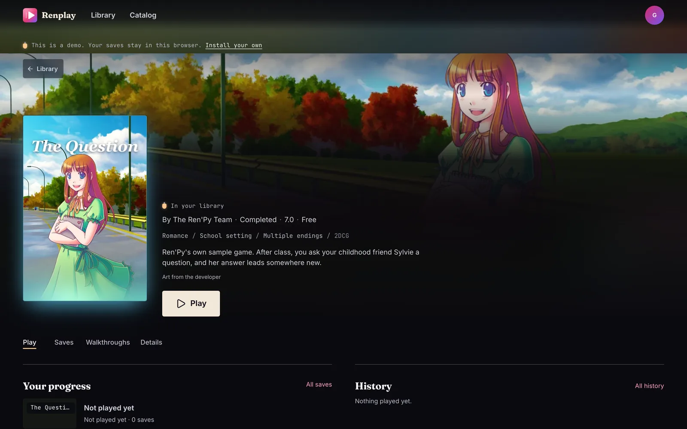
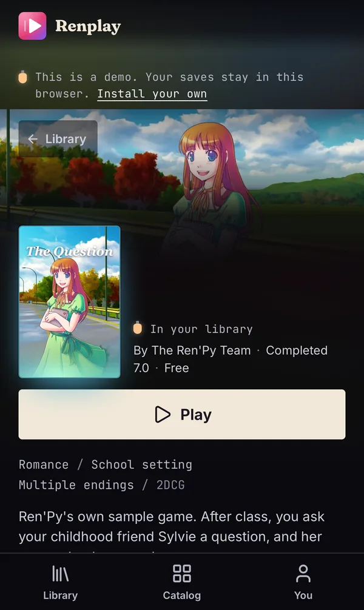
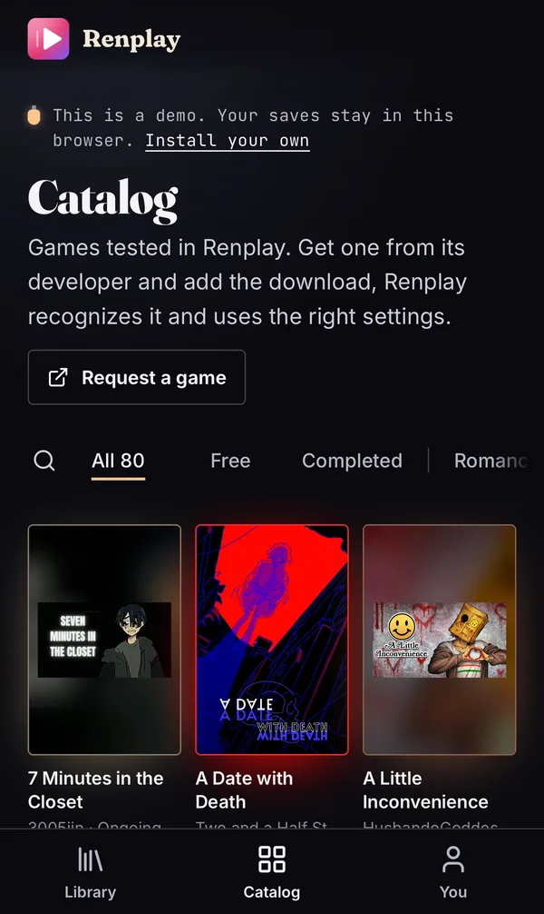
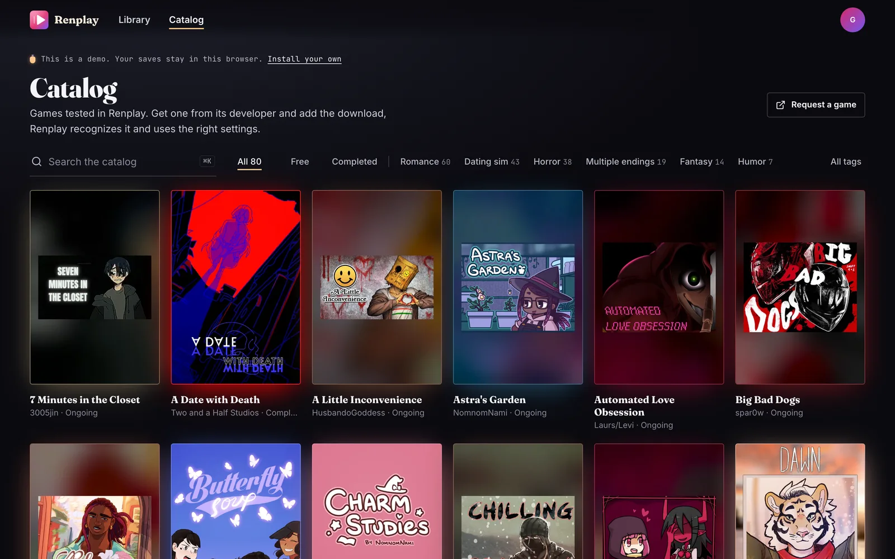

<p align="center"></p>

<h1 align="center">Renplay</h1>

<p align="center"><b>Renplay is a self-hosted player for Ren’Py games in the browser, with saves on your own server.</b></p>

<p align="center"><i>Your Ren’Py games, on every screen.</i></p>

<p align="center">
  <a href="https://github.com/renplay-org/renplay/releases/latest"></a>
  <a href="LICENSE"></a>
  <a href="https://renplay.org/support"></a>
</p>

<p align="center"><a href="https://demo.renplay.org">Try the demo</a> · <a href="https://renplay.org">Website</a> · <a href="https://docs.renplay.org">Docs</a> · <a href="https://renplay.org/catalog">Catalog</a> · <a href="https://renplay.org/releases">Releases</a> · <a href="https://renplay.org/support">Support</a></p>

<p align="center"></p>

Many visual novels come as a PC download. Renplay turns that download into a game you can open in any
browser: on your computer, your tablet or your phone. Add a game’s normal PC download, press
Install and play. Every save goes to your own server the moment the game makes it, so you can stop on
the laptop and carry on from the phone.

Renplay needs a server of your own, such as a home server or a NAS, and runs as one container. It plays
[Ren’Py](https://www.renpy.org/) games first. HTML games, such as Twine stories, play too, with fewer
features. The [docs](https://docs.renplay.org/engines/) say what works.

<p align="center">
  
  &nbsp;
  
</p>

## What it does

- **Plays what you already own.** Games made with Ren’Py 8, and most made with Ren’Py 7, which run on
  the same engine. HTML games play too. Known games come from [a tested catalog](#the-catalog) with
  their art and settings. There is no Ren’Py SDK, and a game’s code never runs on your server.
- **Saves with a history.** Saves, autosaves and unlocked galleries sync the moment the game writes
  them. Every overwrite keeps the version before it, and a sequel finds the first season’s saves, as
  on desktop. Import saves from the desktop version and export them back.
- **Phones, offline, a controller.** Full screen on iPhone and Android, clear of the notch, with the
  screen kept awake while you read. Keep a game in your browser and it plays offline, and its saves go
  up when you are back. A controller moves around the library and plays the game.
- **Everyone in the house.** The games are shared. Saves, favourites and play time belong to each
  person. Sign in with a local account, OpenID Connect or LDAP, or switch person on a shared tablet
  with a PIN.
- **Adult games, on your terms.** Many visual novels are for adults, and Renplay plays them like any
  other game. Each person chooses a level within the limit you set: Off leaves adult games out, Blurred
  shows them without their pictures, and Shown shows everything. At Blurred the server never sends a
  picture of them.
- **Mods, dashboards, your own hardware.** Upload a mod or edit scripts in the browser, and the change
  sits beside the game, so updates never touch it. Prometheus metrics and a Homepage widget show what the
  server is doing. Renplay sends one small anonymous report a day, which you can turn off
  ([what is in it](https://docs.renplay.org/telemetry/)).

## Quick to start, light to carry

Three numbers, measured on 17 November 2026 on one MacBook, with Playwright’s Chromium and WebKit.
The times are the median of five runs, and a phone here means a phone-sized browser window, not a real phone.

| | | How it was measured |
|---|---|---|
| **3 s** from Play to the first frame | 3.2 s in a desktop browser and 2.9 s in an iPhone-sized WebKit window | The Question on [demo.renplay.org](https://demo.renplay.org), the first visit, on a fast connection. From pressing Play to the player’s own ready message, the first frame Ren’Py draws |
| **61 MB** before the first frame | The median for 16 games with a PC download of 1 GB or more (2.0 GB in the middle). The range is 23 to 186 MB, and the rest streams while you play | Computed from the file lists of a test library of tested games: the size of the files the browser needs before the first frame, not a timed run |
| **2 s** back to a game you played before | About 3 KB moves, because the engine and the game are already in your browser | The Question in a desktop browser, a second visit, from pressing Play to the first frame |

On a slow link (Chromium’s Fast 4G preset, 9 Mbps and 170 ms latency) the first visit takes about 20
seconds, because about 20 MB comes over the network once, mostly the Ren’Py engine that every game
of that version shares. The second visit takes 2 to 3.5 seconds.

## The catalog

<p align="center"><a href="https://renplay.org/catalog"></a></p>

Every game in the [catalog](https://renplay.org/catalog) was installed and played in Renplay. It
says which download to get from the developer, brings the official art, and sets what the game
needs. The catalog never hosts game files. Renplay checks it every six hours, links your games to
it and tells you when a newer tested version exists. A game that is not in it still installs and
plays, and a recipe of your own can give it a title and art.

Missing a game? [Request it](https://renplay.org/catalog/request), or add it yourself in the
[catalog repository](https://github.com/renplay-org/catalog).

## Try the demo

[demo.renplay.org](https://demo.renplay.org) is a real copy of Renplay that runs in your browser,
with The Question, Ren’Py’s own sample game, and the whole catalog. Its saves stay in your browser and
nothing can be installed in it.

## Install

Renplay is one container. Give it a folder for games and one for your saves:

```sh
docker run -d --name renplay -p 8080:8080 \
  -v /path/to/games:/games \
  -v /path/to/data:/data \
  ghcr.io/renplay-org/renplay:latest
```

Open http://localhost:8080. On a new install, enter the setup code from `docker logs renplay` and
create the owner account. Copy a game’s PC download into `/path/to/games/_archives/`, or upload it
under **Add games**, and press **Install**. The first install also downloads the Ren’Py web engine
(about 16 MB). Then press **Play**.

- **Pin a version for production.** Use `ghcr.io/renplay-org/renplay:X.Y.Z` with the newest version
  from the [releases](https://renplay.org/releases) instead of `latest`, so an upgrade happens when
  you decide. The same image is on Docker Hub as `renplay/renplay`.
- **Back up `/data`.** It holds your saves and their history, accounts, the library and mods. Keep it
  on local disk, never on a network share. `/games` can be a share. Allow about twice a game’s
  download size free while it installs.
- **The image runs as user 1000.** Both folders must be writable by that user, or use `--user` to run
  as another one. The docs show how, and how to run with a read-only root filesystem.
- **Use HTTPS outside your home network.** New installs ask for sign-in. See
  [Accounts](https://docs.renplay.org/accounts/) before sharing an upgraded install.

More in the docs: [Docker Compose](https://docs.renplay.org/install/docker/),
[Kubernetes](https://docs.renplay.org/install/kubernetes/) (there is also a
[Helm chart](charts/renplay/README.md)), guides for
[TrueNAS](https://docs.renplay.org/install/truenas/), [Unraid](https://docs.renplay.org/install/unraid/),
[Synology](https://docs.renplay.org/install/synology/), [UGREEN](https://docs.renplay.org/install/ugreen/)
and [QNAP](https://docs.renplay.org/install/qnap/),
[adding games](https://docs.renplay.org/guides/adding-games/),
[playing on your phone](https://docs.renplay.org/guides/playing/),
[configuration](https://docs.renplay.org/configuration/) (every environment variable),
[upgrading and backups](https://docs.renplay.org/upgrading/) and
[troubleshooting](https://docs.renplay.org/troubleshooting/).

## Questions

**Which games work?** Ren’Py 8 games, and most Ren’Py 7 games. HTML games such as Twine stories play
too, marked Beta. See [Engines](https://docs.renplay.org/engines/) and the
[catalog](https://renplay.org/catalog), which lists games that were tested.

**Where do I get games?** From their developers: itch.io, Patreon, Steam and so on. Renplay and its
catalog never host game files.

**Can I keep playing on desktop Ren’Py?** Yes. Export a game’s saves and they work in the desktop
version, and the other way round.

**Do I need a big server?** No. Installing a game takes some CPU for a few minutes, and playing is just
serving files, because the game runs in your browser.

More in the [FAQ](https://docs.renplay.org/faq/).

## Get involved

- **Questions**, such as whether a game works, go to [Discussions](https://renplay.org/discussions).
- **Bugs** go to [issues](https://renplay.org/issues).
- **A game to add or fix** belongs in the [catalog](https://github.com/renplay-org/catalog).
- **Code:** read [CONTRIBUTING.md](CONTRIBUTING.md) first. [AGENTS.md](AGENTS.md) holds the product
  rules and lessons learned, for people and AI agents alike. [How Renplay works](https://docs.renplay.org/developers/architecture/)
  explains the pieces. [CHANGELOG.md](CHANGELOG.md) lists what changed in each version.
- **Related repositories:** [catalog](https://github.com/renplay-org/catalog) (recipes and art) and
  [engines](https://github.com/renplay-org/engines) (the Ren’Py web engines).

Renplay is made by the Renplay Team. It is free and open source. If it makes your evenings better, you
can [support it](https://renplay.org/support).

## License

[MIT](LICENSE). Ren’Py is © Tom Rothamel and contributors, under its own license, and Renplay is not
affiliated with it. Games belong to their developers.
