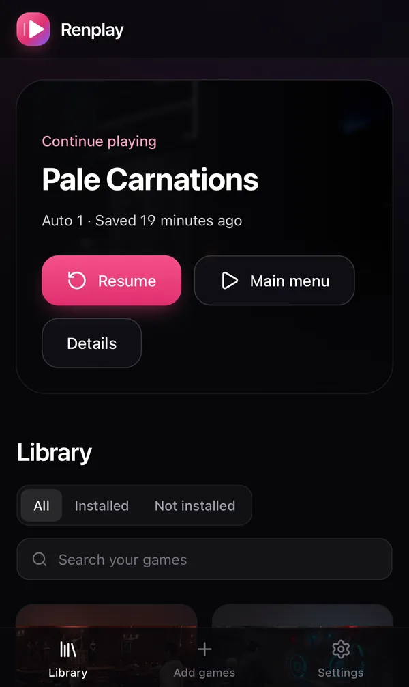

## Find a game

Open **Search** in the header (also available on phones), or press **⌘K** on Apple devices and
**Ctrl+K** elsewhere. Search titles, developers and tags across your library and the catalog,
open a page, or resume your Up next game. Use arrow keys and Enter or tap a result. Catalog
results show where to get the game. Only admins see Add games, Activity and Users.
Search follows your adult games level, as the library does.

## On a computer

Open the game and press **Play**. The game paces itself to your display and fills the screen.
The **Renplay** pill at the top left (or **Esc**, or a swipe from the left edge on a phone) opens
the player menu: **Saves** to load one, **Guide** for the game's walkthroughs, and **Options** for
sound, full screen, the display and Ren'Py's own accessibility menu. **Save now** makes a quick
save, and **Save and exit** saves and goes back to the library. Walkthroughs open in a window
beside the game that you can move, resize and see through, or below it on a phone held upright.
**Up next** on the library home opens your latest save straight away.

## Up next, status and ratings

**Up next** holds the games you are playing, newest first. **Not now** takes a game out of it until
you play it again. On a game's page, under **Play**, set its **Status**: Playing, Stalled, Dropped
or Finished. Stalled, Dropped and Finished leave Up next, and your saves are kept. Rate a game with
up to five stars. The library can sort by **Rating** and **Time played**.

## History

**Account → Play history** shows how long you played, day by day, and the time per game with your
ratings and statuses. A game's page shows its last sessions. Renplay counts the time a game is open
and in front of you. Each person has their own history.

## On a phone

Open Renplay in the phone’s browser and hold the phone sideways. The game fills the screen around
the camera cutout. Every screen works with touch only.

### iPhone and iPad: add it to the Home Screen

Safari cannot show a web page full screen, but a home-screen app can.

1. Open Renplay in Safari.
2. Tap **Share**, then **Add to Home Screen**.
3. Open Renplay from the new icon.

The player explains this itself where a fullscreen button would not work.

### Android

Use the fullscreen button in the player.

Serve Renplay over HTTPS so the browser can cache the game and the home-screen app works. See
[Reverse proxy and HTTPS](/install/reverse-proxy/).

## Saves and history

- Saves, autosaves and progress go to your server **as you make them**. Open the same game on
  another device and its saves are there.
- They are stored the way desktop Ren’Py stores them.
- **Every overwrite and delete keeps the earlier version.** `RENPLAY_SAVE_HISTORY` sets how many
  versions are kept per save file (20 by default). Look at them in the game’s saves view.
- Uninstalling or reinstalling a game never deletes saves.
- Give a save your own name and a note, or **Pin** it, from its menu. A pinned save keeps every
  earlier version instead of the newest few. Only you see names, notes and pins, and the save file
  itself never changes.
- Admins also get a daily zip of everyone's saves. See [Backups](/upgrading/#daily-save-backups).

## Export to desktop Ren’Py, and import from it

Export a game’s saves from its page, or all of them in **Settings**. Put the files in the desktop
game’s save folder and it loads them. The other way works too: import a desktop game’s saves
into Renplay.

## Walkthroughs and play time

A game can keep several walkthroughs: PDFs, pictures and text files. Admins add them under
**Walkthroughs** on the game's page, and rename, reorder or remove them from each one's **More**
menu. Everyone who plays the game can open them. Renplay counts the time a game is open and
visible, and shows it with your latest save. Time is counted from the moment you upgraded to a
version that counts it.
