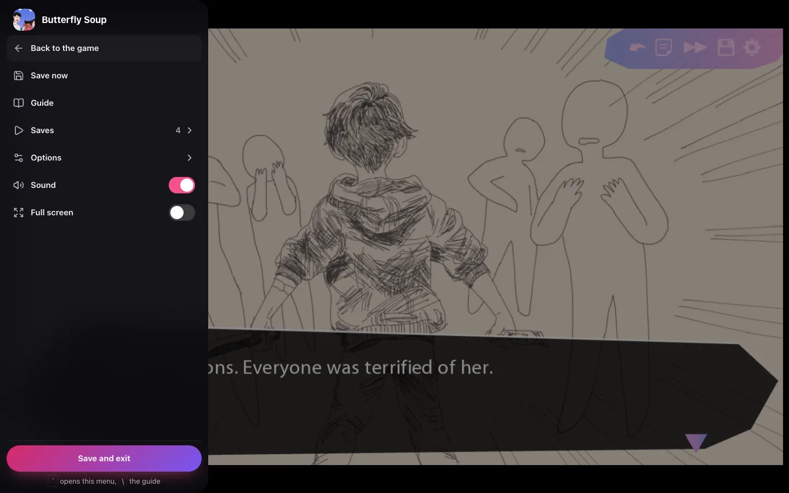

## Find a game

The Library and the Catalog each have one search above their list. Type a title, a developer or a
tag and the list narrows as you type. The Library's heading and the Catalog's **All** button say how
many games it shows, and so does the search itself once it is stuck under the header. Words can come
in any order, accents do not matter, and one wrong, missing, extra or swapped letter is forgiven in a
word of four letters or more. While you type, the best match comes first, and the letters that
matched are marked in the titles. A tag only matches a whole word, or the first three letters or more
of one, so "ro" does not bring every Romance game. Clearing the search puts the list back in the
order you chose. **Clear filters**, the first chip of the row of tags while a tag or a list is on,
takes away the tags and the list and leaves the search, which has its own clear button. When you
start a search the page scrolls smoothly so the search sits under the header with the results below
it, and it does so again if you scroll away and type another letter.

On a computer, press **⌘K** on Apple devices or **Ctrl+K** elsewhere, or **/** when you are not
typing in a field, to go to the search. The tag chips under it say how many of the games shown have
each tag, and **All tags** at the right end of the row opens every tag. In the Library you can choose
more than one tag, and a game must have all of them.
A search that finds nothing in your library offers the same words in the Catalog, where each game
shows where to get it. Only admins see Add games, Activity and Users. Search follows your adult
games level, as the library does.

## On a computer

Open the game and press **Resume** (or **Play** the first time). **Resume** opens your latest save,
and the game's own menu is a tap away for a new game or another save. **Up next** on the library
home resumes straight away.

While the game loads, one bar shows how far it is, from the engine to the game's first screen.
**Game page**, **Sound** and **Full screen** sit at the top, so you can leave, mute or go full
screen before it starts.

The game paces itself to your display. A **Menu** pill sits over it at the top left, with **Full
screen** beside it. The pill is lit for the first seconds of a game and shows the controller's Menu
button while one is connected. The menu shows its keys as keycaps on a computer. Press the pill, press
the **`** key (left of **1**), or swipe from the left edge on a phone to open the player menu:

- **Back to the game** is the first row. **Save now** makes a quick save and says where it went,
  "Saved as Quick 1".
- **Guide** opens the game's walkthroughs, when it has any ([the guide](#the-guide)). On a computer
  the menu stays open and the walkthrough opens beside it. On a phone it takes the menu's place.
- **Saves** lists your saves, with pinned ones first and then the newest. A tap on one saves where
  you are and then loads it, so a mis-tap never loses your place. The last row, **Manage saves on
  the game page**, takes you to where you can pin, name, restore, import and export.
- **Options** has the text size, **Fit** or **Fill**, the camera cutout on a phone, **Rollback** and
  **Skip** even where the game turns them off, Ren'Py's own accessibility screen, the developer
  console and the game's log. The choices for the game are kept with its saves, so they follow you to
  every device, and the game's files do not change. An admin can set Rollback, Skip and the text
  size for everyone who has not chosen ([Defaults for everyone](/accounts/#defaults-for-everyone)).
- **Sound** and **Full screen** are switches. **Save and exit** saves, waits until the server has
  every save, and goes back to where you pressed Play.

**Back to the game** closes the menu and leaves the walkthrough where it is, over the game.

**Esc** goes back one step in the menu and then closes it. In the game, Esc is still Ren'Py's own
menu. In full screen on a computer the menu says **Hold Esc to leave**.

**Options → Picture** decides how the game meets a screen of another shape. **Fit** shows the whole
game in its own shape with bars around it. **Fill** has no bars at the sides: it crops the edges of a
game wider than the screen, and never the top or bottom, where games keep their dialogue.

The **\** key opens and closes the guide when the game has one, also with the menu open. The two
keys work wherever the focus is, also in full screen, and the game never sees them. A name typed into
a game's text field cannot contain them.

## The guide

A game can have walkthroughs: PDFs, pictures and text files. Renplay reads them itself, so they look
the same on every device and never show a browser's toolbar with print and download buttons. An
iPhone shows every page of a PDF, and an Android phone no longer offers to download it.

On a computer the guide is a window over the game. Drag it by its title, resize it from the corner,
and the game stays playable under it. It opens wide enough to read, 42 percent of the screen and at
least 520 px, and then stays where you leave it, with its size, in this browser. A tab for each file
shows when there are several.

- **A small bar** has the page ("3 of 12") with **Previous page** and **Next page**, **Zoom out**,
  **Zoom in** and **Fit**. Fit makes the page as wide as the window. A picture has the same bar
  without pages, and a text file is wrapped text.
- **Zoom** also works by pinching, by holding Ctrl and turning the wheel, and by double tap or
  double click, which switches between Fit and 100 percent. The page and zoom you left are kept for
  each file in this browser.
- **See-through** in the title bar lets the game show through the window. It is on or off, and kept.
- **Pop out** moves the guide into a small window of its own. In Chrome and Edge that window stays on
  top of everything, in full screen too, and can go to another screen. **Bring back**, or closing the
  small window, puts the guide back over the game. In Safari and Firefox it opens a popup window that
  holds only the guide, and closing it brings the guide back. A guide the catalog links is a web page,
  so it opens in a popup window beside the game, not in a tab.
- **With the keyboard**, while focus is in the guide: **Esc** and **\** close it, the arrows scroll,
  **Page Up** and **Page Down** turn pages, **+** and **-** zoom, and **0** fits. A click in the game
  gives the keyboard back to the game and leaves the guide where it is.

On a phone held upright the guide is a sheet over the lower part of the screen, with **Back to the
game** first. Drag the handle at its top, or tap it, to switch between 58 and 92 percent of the
screen. Held sideways the guide fills the screen. A PDF opens at 100 percent, which is readable, and
you pan it. A double tap fits it to the width, and again undoes that. Once you have opened the guide, a
**Guide** pill beside **Menu** switches between the guide and the game in one tap. A phone has no pop out.

## Up next, status and ratings

**Up next** is the top of the library: the games you are playing, newest first, up to eight, one
after the other. It moves on by itself every few seconds. It waits while your finger, the mouse or
the keyboard is on it, and stays where you leave it once you have moved it yourself, with a swipe,
the arrows, the dots under it or the arrow keys. With reduced motion on, it never moves by itself.
**Not now** takes a game out of it until
you play it again. On a game's page, under **Play**, set its **Status**: Playing, Stalled, Dropped
or Finished. Stalled, Dropped and Finished leave Up next, and your saves are kept. Rate a game with
up to five stars. The library can sort by **Rating** and **Time played**.

## History

**Account → Play history** shows how long you played, day by day, and the time per game with your
ratings and statuses. A game's page shows its last sessions. Renplay counts the time a game is open
and in front of you, and stops after 15 minutes without a tap, click or key. Each person has their
own history.

## On a phone

Open Renplay in the phone’s browser. **Resume** and **Play** come right under a game's title, on the
first screen, held upright or sideways. Hold the phone sideways to play: the game fills the screen
around the camera cutout. Every screen works with touch only.

### iPhone and iPad: add it to the Home Screen

Safari cannot show a web page full screen, but a home-screen app can.

1. Open Renplay in Safari.
2. Tap **Share**, then **Add to Home Screen**.
3. Open Renplay from the new icon.

The player explains this itself where a fullscreen button would not work.

### Android

Use **Full screen** beside the **Menu** pill.

Serve Renplay over HTTPS so the browser can cache the game and the home-screen app works. See
[Reverse proxy and HTTPS](/install/reverse-proxy/).

## Play offline

A Ren’Py game can be kept in a browser and played with no network: on a plane, on a train, or
wherever the server is out of reach.

1. Open the game's page while you have a network.
2. Under **Play**, choose **Keep offline**. The game downloads into this browser, with its engine
   and every file it streams. Keep the page open until it says **Kept in this browser**. A stopped
   download continues where it was.
3. With no network, open Renplay as usual. The library says it is offline, and kept games play.

Saves made offline wait on the device. A small amber cloud beside the **Menu** pill says so, and the
menu explains it. They go up when the network is back, with the usual rule when another device saved
too. A game that is already running keeps running when the network drops. Files it still has to
download are the part that cannot arrive without a network. **Update offline copy**
appears when the game gets a new version, and the old copy keeps playing until then. **Remove
offline copy** frees the space. Your saves are never part of it.

- **Room:** a game is often several gigabytes. Renplay checks there is room before it starts, and
  asks the browser to keep the data.
- **iPhone and iPad:** keep games from Renplay on the Home Screen, not a Safari tab: Safari clears
  what a tab keeps after a week without a visit.
- **Shared browsers:** a kept copy belongs to the browser. Offline, a game opens for whoever is
  signed in there, with their own saves, and only if they opened it online before.
- Renplay must be served over HTTPS (or on `localhost`) for a browser to keep games.

## With a controller

A controller works everywhere in Renplay. The d-pad or left stick moves between tiles and buttons,
**A** presses and **B** closes sheets and menus. In a game the controller plays through Ren’Py’s
own buttons: **A** advances and chooses, the d-pad moves through menus, the shoulder buttons roll
back and forward, and **B** opens the game's menu. The **Menu** button (Start) opens the player
menu instead, and closes it again. In the player menu, **A** presses and **B** goes back, then
closes. Hold **Menu** for half a second to open or close the guide.

When the guide has focus it holds the controller, and the game does not see it. The d-pad up and down
scroll, left and right turn pages, **LB** and **RB** switch files, **Y** switches see-through and **X**
goes through Fit, 125 and 150 percent. **B** parks the guide: it stays over the game and the
controller goes back to the game. **Menu** then **Guide** gives the controller to it again. While a
controller is connected, the guide's bar shows these buttons instead of the keys.

## Saves and history

- Saves, autosaves and progress go to your server **as you make them**. Open the same game on
  another device and its saves are there.
- They are stored the way desktop Ren’Py stores them.
- **Every overwrite and delete keeps the earlier version.** `RENPLAY_SAVE_HISTORY` sets how many
  versions are kept per save file (20 by default). Look at them in the game’s saves view.
- Uninstalling or reinstalling a game never deletes saves.
- When two devices change the same save without seeing each other's copy, the copy saved later
  stays in the slot and the other is kept in History. The player and the game's saves both say so.
- Give a save your own name and a note, or **Pin** it, from its menu. A pinned save keeps every
  earlier version instead of the newest few. Only you see names, notes and pins, and the save file
  itself never changes.
- Admins also get a daily zip of everyone's saves. See [Backups](/upgrading/#daily-save-backups).

## Export to desktop Ren’Py, and import from it

Export a game’s saves from its page (**Export all** under **Saves**), or all of yours from
**Account** (**Export all my saves**). Put the files in the desktop
game’s save folder and it loads them.

To bring saves the other way, open **Account** on the computer where you played and choose
**Import from a computer** (admins also find it in **Settings**). Renplay shows where Ren’Py keeps saves on that system
(`~/Library/RenPy` on a Mac, `%APPDATA%\RenPy` on Windows, `~/.renpy` on Linux). Choose that
folder, or a zip of it, and a preview lists each game's saves as new, newer or older than the
server's copy before anything is written. Older copies never replace newer ones: they are kept in
History. Saves for games you have not added yet wait on the server until you add them. To import
saves for one game only, use **Import** under the game's **Saves**.

### Sync codes

Games made with Ren’Py 8.1 or newer have **Upload Sync** and **Download Sync** on their save and
load screens. Renplay speaks the same codes, once an admin turns on **Sync codes** in
**Settings**. Under the game's **Saves**, **Sync code** makes a code from your saves to type into
Download Sync on a computer or Android phone, or brings in the saves from a code that Upload Sync
made there. The saves travel encrypted through Ren’Py’s sync server, which keeps them for an hour,
and they leave your server only when you ask for a code. Saves brought in follow the rule for two
devices: the newer copy stays in the slot and the other is kept in History.

## Walkthroughs and play time

A game can keep several walkthroughs: PDFs, pictures and text files. Admins add them under
**Walkthroughs** on the game's page, and rename, reorder or remove them from each one's **More**
menu. Everyone who plays the game can open them. Renplay counts the time a game is open and
visible, and shows it with your latest save. Time is counted from the moment you upgraded to a
version that counts it.
