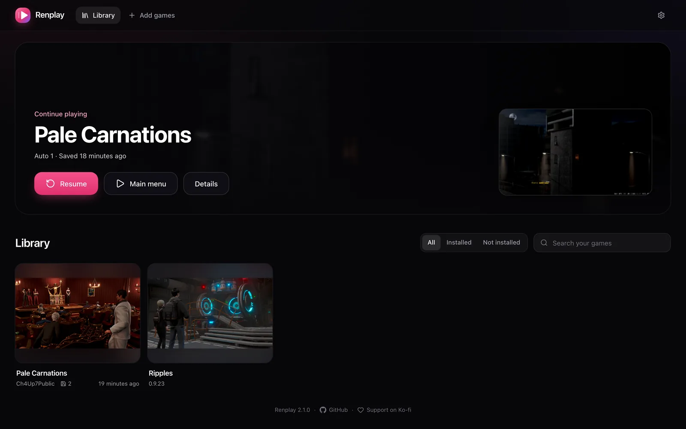

Renplay is a self-hosted library for the visual novels you download. You add a game’s normal PC
download, press **Install**, and play it in any browser: on your computer, tablet or phone. Every
save lands on your server the moment you make it, so you can stop on the laptop and continue on the
phone.

## What it plays

- **Ren’Py games**, the focus. Ren’Py 8 games, and most Ren’Py 7 games, which run on the Ren’Py 8
  engine. Only games with Python 2-only code have trouble.
- **HTML games**, such as Twine stories, shown as Beta. See [Engines](/engines/) for what works and
  what does not.

Games come from their developers (itch.io, Patreon, Steam and so on). Renplay and its catalog never
host game files.

## How it works

- Renplay reads the download, converts images to WebP, and builds a web version. No Ren’Py SDK is
  needed, and the game’s code never runs on your server.
- The game starts in the browser. Assets stream as the game needs them, and the engine and the
  game are cached in the browser.
- Saves, autosaves and progress sync to the server as you play, with earlier versions kept. They
  are laid out like desktop Ren’Py’s, so you can export them to the desktop version and back.
- The [catalog](/catalog/) gives known games their title, developer, art and tested settings.
- A game can be kept in a browser and played with no network, and a controller plays it like a
  console. See [Playing](/guides/playing/).
- Several people can share one server, each with their own saves, levels for adult games and play
  history. See [Accounts](/accounts/).

## What it does not do

- It does not download games for you. Add the file yourself.
- It is not a public service. Run it for yourself and the people you trust, and use
  [HTTPS](/install/reverse-proxy/) outside your own network.
- It does not play every engine. Programs made for Windows only, such as RPG Maker XP or Wolf RPG,
  cannot run in a browser.

## Requirements

- A machine that runs Docker (or Kubernetes). The image is built for amd64 and arm64, so a
  server, a NAS or an ARM board all work.
- Disk space: an installed game takes about as much as its download. Put the games folder on a
  big disk.
- A modern browser on the device you play on.

Next: [Quick start](/start-here/quick-start/).
